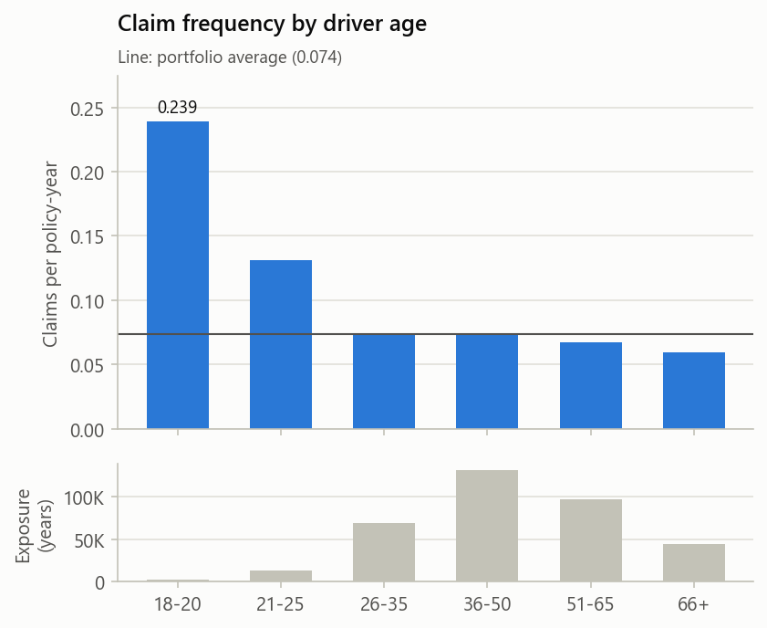
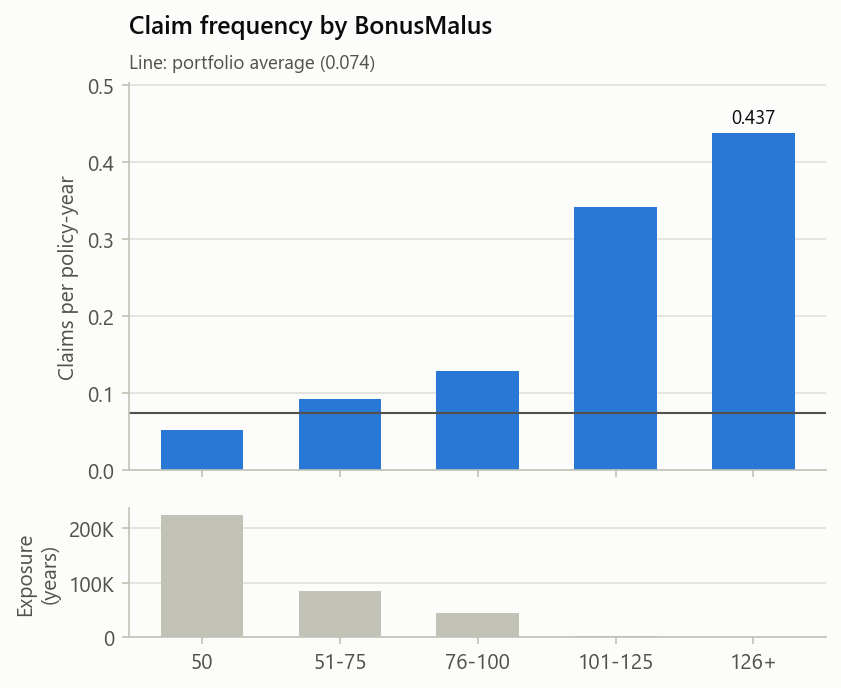
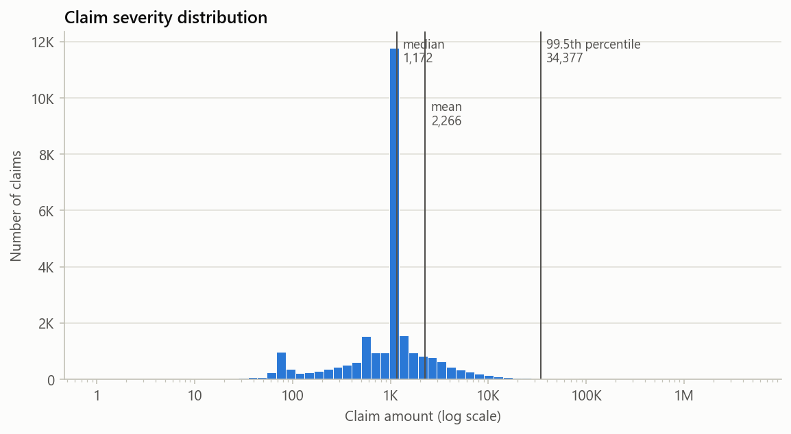
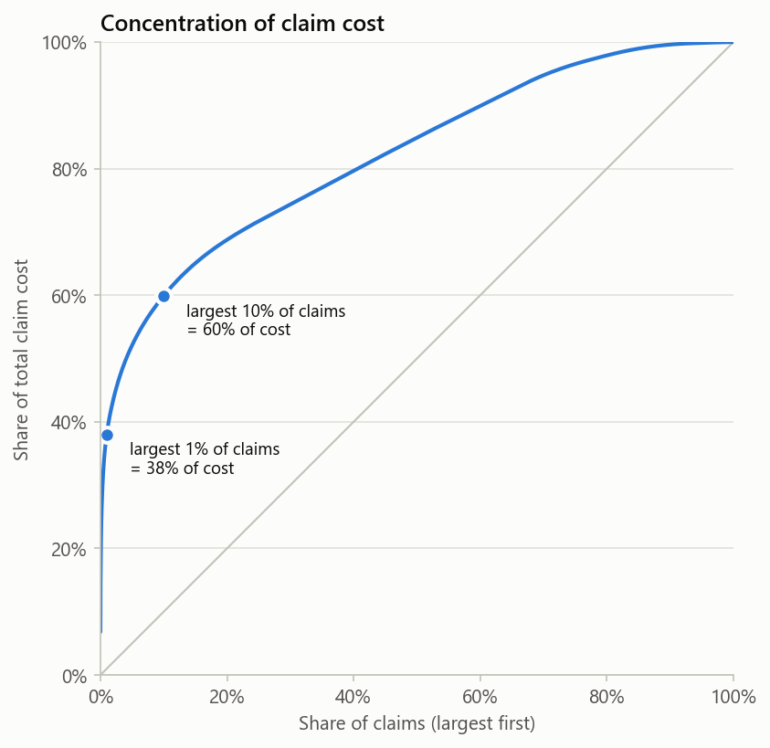
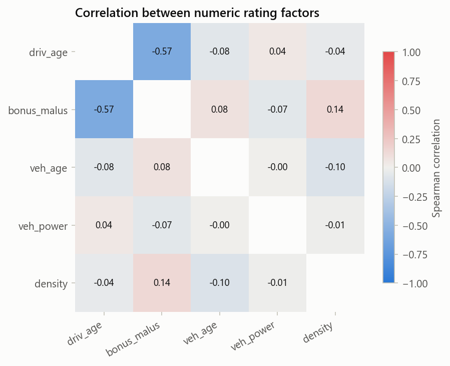
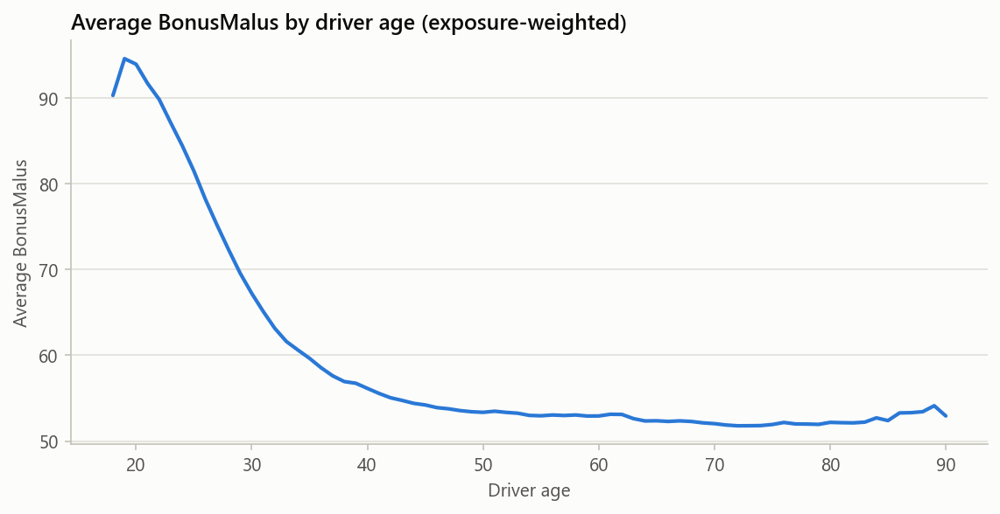

# pricing-project

## Data pipeline

### Raw load

Loaded 678,013 policies (`policies_raw`) and 26,639 claims (`claims_raw`) from OpenML freMTPL2freq / freMTPL2sev into MySQL; row counts reconciled against the CSVs.

### Data quality and clean layer

Checks in [`sql/02_data_quality.sql`](sql/02_data_quality.sql) were run on the raw tables, then re-run on the clean layer built by [`sql/03_clean_layer.sql`](sql/03_clean_layer.sql).

| Check | Raw | Decision | Clean |
| --- | ---: | --- | ---: |
| Policies with exposure > 1 | 1,224 | Cap at 1 (exposure is in policy-years) | 0 |
| Policies with claim_nb > 4 | 9 | Cap at 4 | 0 |
| Orphan claims (no matching policy) | 195 | Exclude | 0 |
| Policies with claim_nb > 0 but no severity rows | 9,116 | Set claims to 0 | 0 |
| Zero-amount claims | 0 | Drop (none found) | 0 |

**Result:** the clean layer keeps all 678,013 policies and 26,444 claims (195 orphans removed).

**Findings:**

- 9,116 policies report claims but have no claim amounts. Setting their claims to 0 keeps frequency and severity consistent, so frequency × severity = pure premium.
- Claim severity is heavy-tailed: mean 2,278.54, max 4,075,400.56. Large claims will be capped in the severity model.
- The capped claim counts may not be errors: the 8 policies with more than 4 claims that have severity rows have exactly as many rows as claims.
- After cleaning, 9 policies have a claim_nb that differs from their number of claim rows. This is expected: 8 come from the cap at 4 (their claim rows are kept), and 1 is a policy with 2 claims but 1 severity row in the source data.

## Exploratory analysis

Queries in [`sql/04_eda.sql`](sql/04_eda.sql), run on the clean layer.

### Portfolio overview

| Policies | Claims | Exposure (years) | Frequency | Avg severity | Pure premium |
| ---: | ---: | ---: | ---: | ---: | ---: |
| 678,013 | 26,406 | 358,360 | 0.0737 | 2,268.77 | 167.18 |

Frequency = claims / exposure; severity = claim cost / claims; pure premium = claim cost / exposure (= frequency × severity).

### By driver age band

| Age band | Exposure (years) | Frequency | Avg severity | Pure premium |
| --- | ---: | ---: | ---: | ---: |
| 18-20 | 2,585 | 0.2387 | 13,431.20 | 3,206.39 |
| 21-25 | 13,643 | 0.1310 | 2,249.70 | 294.68 |
| 26-35 | 69,238 | 0.0746 | 2,052.88 | 153.20 |
| 36-50 | 131,927 | 0.0733 | 1,895.13 | 138.94 |
| 51-65 | 96,723 | 0.0676 | 1,892.62 | 128.03 |
| 66+ | 44,246 | 0.0592 | 2,397.55 | 141.97 |

### By region

The 3 regions with the most claim cost (R24, R82, R93) account for 60% of it. The 2 highest pure premiums, R21 (399.59) and R94 (263.08), come from regions with only 0.8% of total cost each.

### Large claims

The top 1% of claims make up 38% of total claim cost.

### By BonusMalus

| BonusMalus | Exposure (years) | Frequency | Avg severity | Pure premium |
| --- | ---: | ---: | ---: | ---: |
| 50 | 225,153 | 0.0513 | 1,928.71 | 98.97 |
| 51-75 | 84,830 | 0.0923 | 1,997.27 | 184.40 |
| 76-100 | 44,806 | 0.1287 | 3,369.35 | 433.52 |
| 101-125 | 3,198 | 0.3418 | 1,844.08 | 630.33 |
| 126+ | 373 | 0.4369 | 3,339.58 | 1,459.18 |

### By vehicle age

| Vehicle age | Exposure (years) | Frequency | Avg severity | Pure premium |
| --- | ---: | ---: | ---: | ---: |
| 0 | 16,696 | 0.0707 | 1,985.54 | 140.45 |
| 1-4 | 112,269 | 0.0733 | 2,104.78 | 154.35 |
| 5-10 | 121,168 | 0.0799 | 1,959.95 | 156.67 |
| 11-20 | 103,082 | 0.0689 | 2,932.63 | 201.96 |
| 21+ | 5,145 | 0.0402 | 2,091.04 | 84.14 |

### By vehicle power

| Vehicle power | Exposure (years) | Frequency | Avg severity | Pure premium |
| --- | ---: | ---: | ---: | ---: |
| 4 | 60,055 | 0.0660 | 2,373.29 | 156.69 |
| 5 | 68,148 | 0.0751 | 1,727.81 | 129.68 |
| 6 | 82,498 | 0.0764 | 2,281.67 | 174.38 |
| 7 | 77,920 | 0.0718 | 2,222.17 | 159.48 |
| 8 | 22,674 | 0.0726 | 1,795.06 | 130.31 |
| 9 | 15,339 | 0.0795 | 5,135.29 | 408.45 |
| 10 | 15,367 | 0.0792 | 2,344.55 | 185.68 |
| 11 | 8,491 | 0.0841 | 1,837.72 | 154.53 |
| 12 | 3,791 | 0.0781 | 2,390.82 | 186.68 |
| 13 | 1,637 | 0.0849 | 2,233.84 | 189.67 |
| 14 | 1,180 | 0.0856 | 3,182.38 | 272.39 |
| 15 | 1,260 | 0.0762 | 1,294.52 | 98.59 |

### By area

| Area | Exposure (years) | Avg density | Frequency | Avg severity | Pure premium |
| --- | ---: | ---: | ---: | ---: | ---: |
| A | 61,957 | 28 | 0.0543 | 2,300.72 | 124.92 |
| B | 43,002 | 73 | 0.0612 | 3,370.29 | 206.36 |
| C | 104,403 | 249 | 0.0679 | 2,060.07 | 139.96 |
| D | 77,088 | 1,076 | 0.0833 | 2,256.11 | 187.92 |
| E | 63,786 | 4,380 | 0.0960 | 2,126.68 | 204.08 |
| F | 8,125 | 22,015 | 0.0953 | 1,524.04 | 145.17 |

### By fuel type

| Fuel | Exposure (years) | Frequency | Avg severity | Pure premium |
| --- | ---: | ---: | ---: | ---: |
| Diesel | 170,588 | 0.0788 | 2,051.80 | 161.76 |
| Regular | 187,773 | 0.0690 | 2,493.98 | 172.09 |

Diesel claim frequency ÷ regular claim frequency = 1.14.

### By population density

| Density (per km²) | Exposure (years) | Frequency | Avg severity | Pure premium |
| --- | ---: | ---: | ---: | ---: |
| <50 | 61,460 | 0.0543 | 2,290.88 | 124.46 |
| 50-199 | 87,864 | 0.0630 | 2,564.86 | 161.69 |
| 200-499 | 60,032 | 0.0702 | 2,224.52 | 156.08 |
| 500-1999 | 77,093 | 0.0833 | 2,256.11 | 187.91 |
| 2000-9999 | 63,786 | 0.0960 | 2,126.68 | 204.08 |
| 10000+ | 8,125 | 0.0953 | 1,524.04 | 145.17 |

**Findings:**

- Claim frequency falls steadily with age, from 0.239 at 18-20 to 0.059 at 66+, roughly a 4× difference. Driver age is a strong frequency rating factor.
- The 18-20 band's average severity (13,431) is 6–7× that of the other bands, but it comes from a few very large claims, not from generally more expensive claims. Its 3 largest claims make up 82% of its claim cost; without them, its average claim is 2,455, compared with 2,009 for all claims after removing their 3 largest. The band is also thin (2,585 exposure years, under 1% of the portfolio), so it should be merged, or large claims capped, before modelling severity by age.
- Severity is roughly flat across the bands from 21 to 65 (about 1,890-2,250), so the age effect is mainly in frequency. Severity rises again at 66+ (2,398).
- Claim cost is concentrated by region: 3 of 22 regions carry 60% of it. Small regions such as R21 and R94 have the highest pure premiums, but their low volume makes those estimates unreliable. They should be credibility-weighted or grouped rather than rated on their own experience.
- Large claims dominate: the top 1% of claims make up 38% of cost. This confirms that large claims need capping, with the excess spread across the portfolio, in the severity model.
- The 26,406 claims in `policies_clean` are 38 fewer than the 26,444 claim rows in `claims_clean`. The cap at 4 claims per policy removes 39 claims from 8 policies, and 1 policy has 2 claims but only 1 claim row.
- BonusMalus is the strongest frequency factor found so far: frequency rises from 0.051 at the best score (50) to 0.437 at 126+, about 8.5×. Above 100 the bands are thin (about 1% of exposure), so the top bands will need merging or a smooth curve in the GLM.
- Vehicle age and vehicle power have weak effects on frequency. Frequency stays between 0.069 and 0.080 for vehicles up to 20 years old, and rises only slightly with power, from 0.066 at 4 to about 0.085 at 13–14. The severity spike at power 9 (5,135) comes from a single claim: without it, the average claim at power 9 is 1,796, below the portfolio average.
- Vehicles older than 20 years claim less often (0.040), but this band is small and includes implausible ages of up to 100 years. This supports capping `veh_age` at 20.
- Diesel cars claim 1.14× as often as petrol cars but have lower severity (2,052 vs 2,494), so their pure premiums are close (162 vs 172).
- Frequency rises with population density, from 0.054 under 50 per km² to 0.096 at 2,000–9,999, then levels off. Severity does not rise with density.
- One claim of 4,075,400.56 (claim 9757 on policy 1120377), the largest in the data, inflates the average severity of every group it falls in. The policy has a 19-year-old driver, vehicle power 9, area B, BonusMalus 100 and a 13-year-old vehicle, so the claim raises the average for driver age 18-20, power 9, area B, BonusMalus 76-100 and vehicle age 11-20. Without it, area B's average claim falls from 3,370 to 1,823 and BonusMalus 76-100's from about 3,370 to 2,663. On its own it is 6.8% of all claim cost, which is why large claims must be capped before fitting the severity model.
- Area is a banded version of density. Each area covers its own density range: A 1–50, B 50–100, C 100–500, D 500–1,993, E 2,001–9,850 and F 10,008–27,000 (the ranges meet only at the edge values 50, 100 and 500). Areas E and F have exactly the same exposure, frequency and severity as the 2,000–9,999 and 10,000+ density bands. Area and density carry the same information, so the model should use only one of them.

### Charts

Drawn in [`02_eda.ipynb`](02_eda.ipynb) from the clean layer; the notebook checks its numbers against `sql/04_eda.sql` before plotting. All charts are in [`figures/`](figures/). In each frequency chart, the lower panel shows the exposure behind each bar.

**Findings from the charts:**

- Claim amounts cluster tightly: the median is 1,172, and 45.7% of all claims fall between 1,000 and 1,300. The mean (2,266) is about twice the median because of the long tail.
- The 99.5th-percentile claim is 34,377. This is the large-claim cap for the severity model in Step 4.
- Claim cost is concentrated: the largest 1% of claims make up 38% of total cost, and the largest 10% make up 60%.
- Driver age and BonusMalus are strongly related (Spearman correlation −0.57). The exposure-weighted average BonusMalus is about 90–94 for drivers aged 18–20 and about 53 from age 50 onwards. Because young drivers also tend to have high BonusMalus, the one-way tables above mix the two effects: the driver-age table partly reflects BonusMalus and vice versa. The GLM in Step 5 estimates each factor while holding the other fixed, which will show how much of each effect remains. All other pairs of numeric factors are weakly related (between −0.10 and 0.14).
