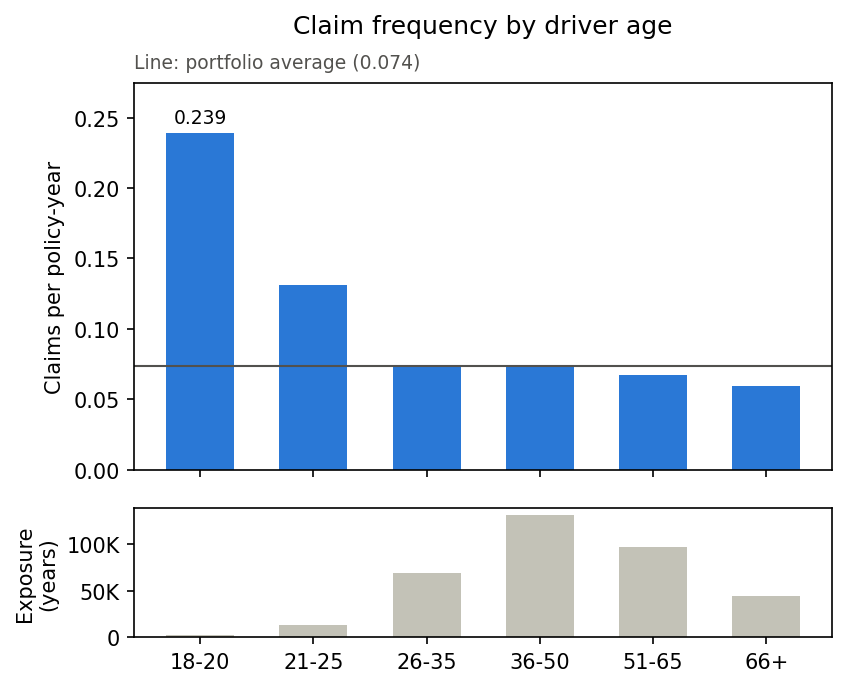
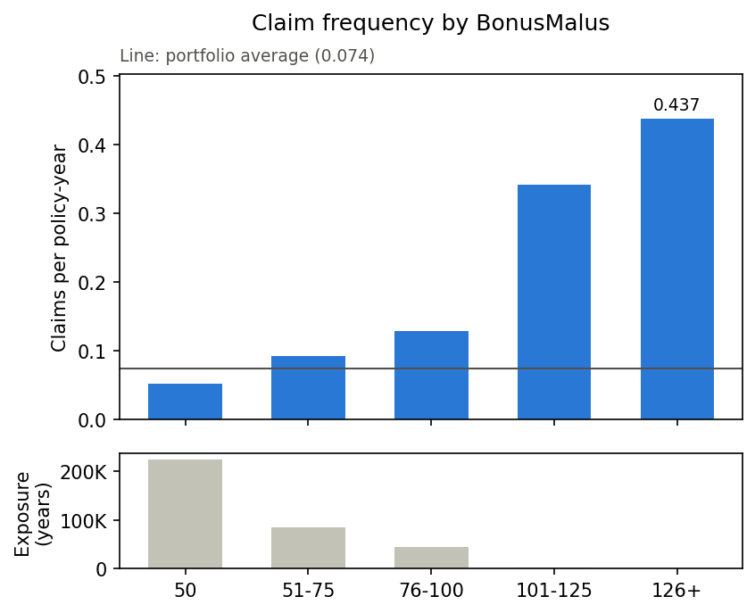
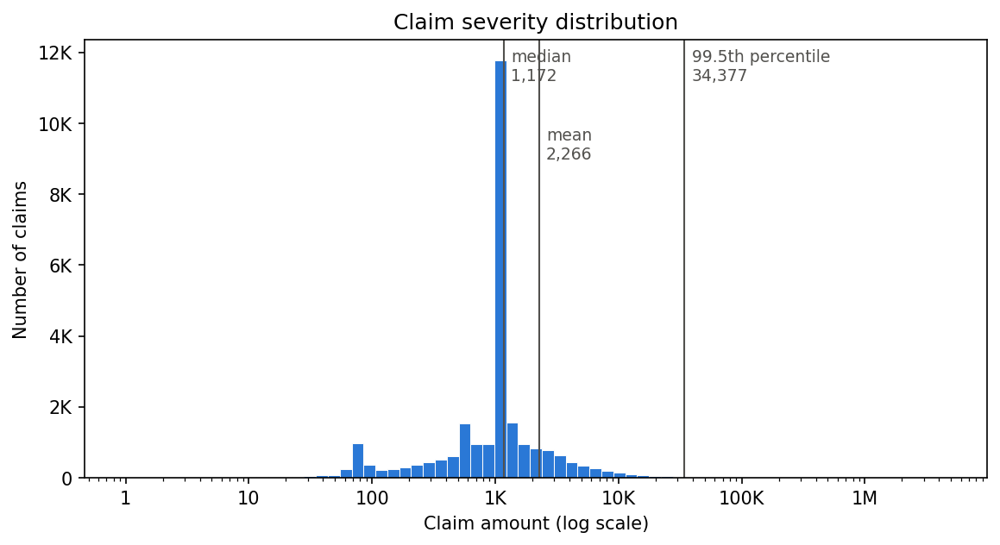
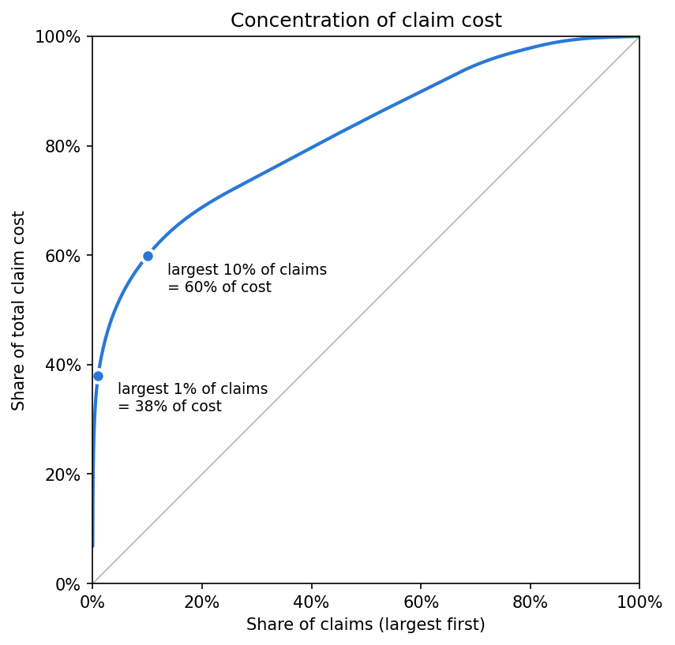
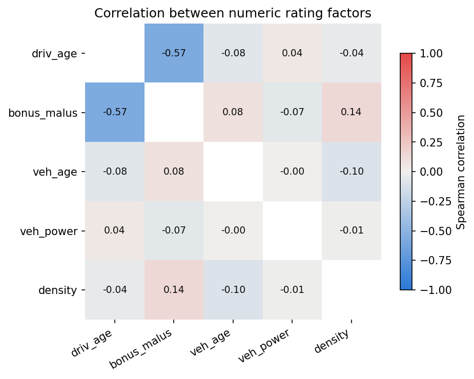
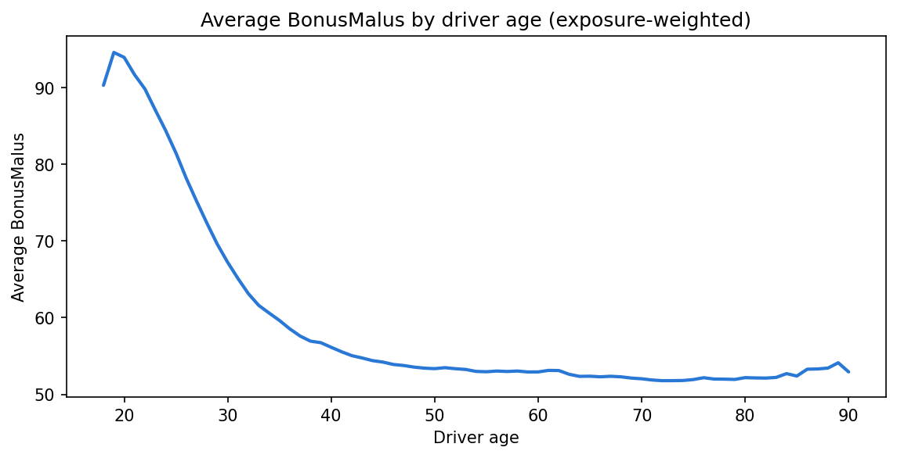
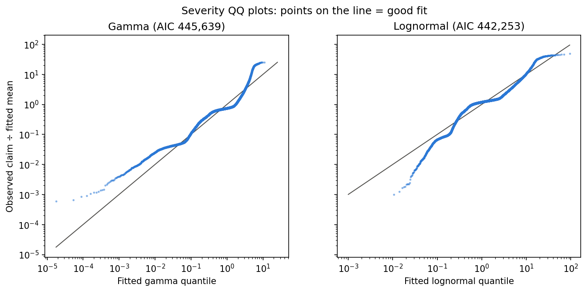
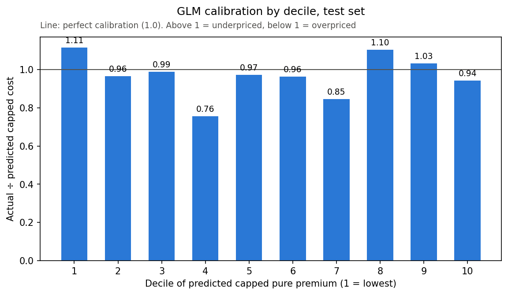

# pricing-project

## Data pipeline

### Raw load

Loaded 678,013 policies (`policies_raw`) and 26,639 claims (`claims_raw`) from OpenML freMTPL2freq / freMTPL2sev into MySQL; row counts reconciled against the CSVs.

### Data quality and clean layer

Checks in [`sql/02_data_quality.sql`](sql/02_data_quality.sql) were run on the raw tables, then re-run on the clean layer built by [`sql/03_clean_layer.sql`](sql/03_clean_layer.sql).

| Check | Raw | Decision | Clean |
| --- | ---: | --- | ---: |
| Policies with exposure > 1 | 1,224 | Cap at 1 (exposure is in policy-years) | 0 |
| Policies with claim_nb > 4 | 9 | Cap at 4 | 0 |
| Orphan claims (no matching policy) | 195 | Exclude | 0 |
| Policies with claim_nb > 0 but no severity rows | 9,116 | Set claims to 0 | 0 |
| Zero-amount claims | 0 | Drop (none found) | 0 |

**Result:** the clean layer keeps all 678,013 policies and 26,444 claims (195 orphans removed).

**Findings:**

- 9,116 policies report claims but have no claim amounts. Setting their claims to 0 keeps frequency and severity consistent, so frequency × severity = pure premium.
- Claim severity is heavy-tailed: mean 2,278.54, max 4,075,400.56. Large claims will be capped in the severity model.
- The capped claim counts may not be errors: the 8 policies with more than 4 claims that have severity rows have exactly as many rows as claims.
- After cleaning, 9 policies have a claim_nb that differs from their number of claim rows. This is expected: 8 come from the cap at 4 (their claim rows are kept), and 1 is a policy with 2 claims but 1 severity row in the source data.

## Exploratory analysis

Queries in [`sql/04_eda.sql`](sql/04_eda.sql), run on the clean layer.

### Portfolio overview

| Policies | Claims | Exposure (years) | Frequency | Avg severity | Pure premium |
| ---: | ---: | ---: | ---: | ---: | ---: |
| 678,013 | 26,406 | 358,360 | 0.0737 | 2,268.77 | 167.18 |

Frequency = claims / exposure; severity = claim cost / claims; pure premium = claim cost / exposure (= frequency × severity).

### By driver age band

| Age band | Exposure (years) | Frequency | Avg severity | Pure premium |
| --- | ---: | ---: | ---: | ---: |
| 18-20 | 2,585 | 0.2387 | 13,431.20 | 3,206.39 |
| 21-25 | 13,643 | 0.1310 | 2,249.70 | 294.68 |
| 26-35 | 69,238 | 0.0746 | 2,052.88 | 153.20 |
| 36-50 | 131,927 | 0.0733 | 1,895.13 | 138.94 |
| 51-65 | 96,723 | 0.0676 | 1,892.62 | 128.03 |
| 66+ | 44,246 | 0.0592 | 2,397.55 | 141.97 |

### By region

The 3 regions with the most claim cost (R24, R82, R93) account for 60% of it. The 2 highest pure premiums, R21 (399.59) and R94 (263.08), come from regions with only 0.8% of total cost each.

### Large claims

The top 1% of claims make up 38% of total claim cost.

### By BonusMalus

| BonusMalus | Exposure (years) | Frequency | Avg severity | Pure premium |
| --- | ---: | ---: | ---: | ---: |
| 50 | 225,153 | 0.0513 | 1,928.71 | 98.97 |
| 51-75 | 84,830 | 0.0923 | 1,997.27 | 184.40 |
| 76-100 | 44,806 | 0.1287 | 3,369.35 | 433.52 |
| 101-125 | 3,198 | 0.3418 | 1,844.08 | 630.33 |
| 126+ | 373 | 0.4369 | 3,339.58 | 1,459.18 |

### By vehicle age

| Vehicle age | Exposure (years) | Frequency | Avg severity | Pure premium |
| --- | ---: | ---: | ---: | ---: |
| 0 | 16,696 | 0.0707 | 1,985.54 | 140.45 |
| 1-4 | 112,269 | 0.0733 | 2,104.78 | 154.35 |
| 5-10 | 121,168 | 0.0799 | 1,959.95 | 156.67 |
| 11-20 | 103,082 | 0.0689 | 2,932.63 | 201.96 |
| 21+ | 5,145 | 0.0402 | 2,091.04 | 84.14 |

### By vehicle power

| Vehicle power | Exposure (years) | Frequency | Avg severity | Pure premium |
| --- | ---: | ---: | ---: | ---: |
| 4 | 60,055 | 0.0660 | 2,373.29 | 156.69 |
| 5 | 68,148 | 0.0751 | 1,727.81 | 129.68 |
| 6 | 82,498 | 0.0764 | 2,281.67 | 174.38 |
| 7 | 77,920 | 0.0718 | 2,222.17 | 159.48 |
| 8 | 22,674 | 0.0726 | 1,795.06 | 130.31 |
| 9 | 15,339 | 0.0795 | 5,135.29 | 408.45 |
| 10 | 15,367 | 0.0792 | 2,344.55 | 185.68 |
| 11 | 8,491 | 0.0841 | 1,837.72 | 154.53 |
| 12 | 3,791 | 0.0781 | 2,390.82 | 186.68 |
| 13 | 1,637 | 0.0849 | 2,233.84 | 189.67 |
| 14 | 1,180 | 0.0856 | 3,182.38 | 272.39 |
| 15 | 1,260 | 0.0762 | 1,294.52 | 98.59 |

### By area

| Area | Exposure (years) | Avg density | Frequency | Avg severity | Pure premium |
| --- | ---: | ---: | ---: | ---: | ---: |
| A | 61,957 | 28 | 0.0543 | 2,300.72 | 124.92 |
| B | 43,002 | 73 | 0.0612 | 3,370.29 | 206.36 |
| C | 104,403 | 249 | 0.0679 | 2,060.07 | 139.96 |
| D | 77,088 | 1,076 | 0.0833 | 2,256.11 | 187.92 |
| E | 63,786 | 4,380 | 0.0960 | 2,126.68 | 204.08 |
| F | 8,125 | 22,015 | 0.0953 | 1,524.04 | 145.17 |

### By fuel type

| Fuel | Exposure (years) | Frequency | Avg severity | Pure premium |
| --- | ---: | ---: | ---: | ---: |
| Diesel | 170,588 | 0.0788 | 2,051.80 | 161.76 |
| Regular | 187,773 | 0.0690 | 2,493.98 | 172.09 |

Diesel claim frequency ÷ regular claim frequency = 1.14.

### By population density

| Density (per km²) | Exposure (years) | Frequency | Avg severity | Pure premium |
| --- | ---: | ---: | ---: | ---: |
| <50 | 61,460 | 0.0543 | 2,290.88 | 124.46 |
| 50-199 | 87,864 | 0.0630 | 2,564.86 | 161.69 |
| 200-499 | 60,032 | 0.0702 | 2,224.52 | 156.08 |
| 500-1999 | 77,093 | 0.0833 | 2,256.11 | 187.91 |
| 2000-9999 | 63,786 | 0.0960 | 2,126.68 | 204.08 |
| 10000+ | 8,125 | 0.0953 | 1,524.04 | 145.17 |

**Findings:**

- Claim frequency falls steadily with age, from 0.239 at 18-20 to 0.059 at 66+, roughly a 4× difference. Driver age is a strong frequency rating factor.
- The 18-20 band's average severity (13,431) is 6–7× that of the other bands, but it comes from a few very large claims, not from generally more expensive claims. Its 3 largest claims make up 82% of its claim cost; without them, its average claim is 2,455, compared with 2,009 for all claims after removing their 3 largest. The band is also thin (2,585 exposure years, under 1% of the portfolio), so it should be merged, or large claims capped, before modelling severity by age.
- Severity is roughly flat across the bands from 21 to 65 (about 1,890-2,250), so the age effect is mainly in frequency. Severity rises again at 66+ (2,398).
- Claim cost is concentrated by region: 3 of 22 regions carry 60% of it. Small regions such as R21 and R94 have the highest pure premiums, but their low volume makes those estimates unreliable. They should be credibility-weighted or grouped rather than rated on their own experience.
- Large claims dominate: the top 1% of claims make up 38% of cost. This confirms that large claims need capping, with the excess spread across the portfolio, in the severity model.
- The 26,406 claims in `policies_clean` are 38 fewer than the 26,444 claim rows in `claims_clean`. The cap at 4 claims per policy removes 39 claims from 8 policies, and 1 policy has 2 claims but only 1 claim row.
- BonusMalus is the strongest frequency factor found so far: frequency rises from 0.051 at the best score (50) to 0.437 at 126+, about 8.5×. Above 100 the bands are thin (about 1% of exposure), so the top bands will need merging or a smooth curve in the GLM.
- Vehicle age and vehicle power have weak effects on frequency. Frequency stays between 0.069 and 0.080 for vehicles up to 20 years old, and rises only slightly with power, from 0.066 at 4 to about 0.085 at 13–14. The severity spike at power 9 (5,135) comes from a single claim: without it, the average claim at power 9 is 1,796, below the portfolio average.
- Vehicles older than 20 years claim less often (0.040), but this band is small and includes implausible ages of up to 100 years. This supports capping `veh_age` at 20.
- Diesel cars claim 1.14× as often as petrol cars but have lower severity (2,052 vs 2,494), so their pure premiums are close (162 vs 172).
- Frequency rises with population density, from 0.054 under 50 per km² to 0.096 at 2,000–9,999, then levels off. Severity does not rise with density.
- One claim of 4,075,400.56 (claim 9757 on policy 1120377), the largest in the data, inflates the average severity of every group it falls in. The policy has a 19-year-old driver, vehicle power 9, area B, BonusMalus 100 and a 13-year-old vehicle, so the claim raises the average for driver age 18-20, power 9, area B, BonusMalus 76-100 and vehicle age 11-20. Without it, area B's average claim falls from 3,370 to 1,823 and BonusMalus 76-100's from about 3,370 to 2,663. On its own it is 6.8% of all claim cost, which is why large claims must be capped before fitting the severity model.
- Area is a banded version of density. Each area covers its own density range: A 1–50, B 50–100, C 100–500, D 500–1,993, E 2,001–9,850 and F 10,008–27,000 (the ranges meet only at the edge values 50, 100 and 500). Areas E and F have exactly the same exposure, frequency and severity as the 2,000–9,999 and 10,000+ density bands. Area and density carry the same information, so the model should use only one of them.

### Charts

Drawn in [`02_eda.ipynb`](02_eda.ipynb) from the clean layer; the notebook checks its numbers against `sql/04_eda.sql` before plotting. All charts are in [`figures/`](figures/). In each frequency chart, the lower panel shows the exposure behind each bar.

**Findings from the charts:**

- Claim amounts cluster tightly: the median is 1,172, and 45.7% of all claims fall between 1,000 and 1,300. The mean (2,266) is about twice the median because of the long tail.
- The 99.5th-percentile claim is 34,377. This is the large-claim cap for the severity model in Step 4.
- Claim cost is concentrated: the largest 1% of claims make up 38% of total cost, and the largest 10% make up 60%.
- Driver age and BonusMalus are strongly related (Spearman correlation −0.57). The exposure-weighted average BonusMalus is about 90–94 for drivers aged 18–20 and about 53 from age 50 onwards. Because young drivers also tend to have high BonusMalus, the one-way tables above mix the two effects: the driver-age table partly reflects BonusMalus and vice versa. The GLM in Step 5 estimates each factor while holding the other fixed, which will show how much of each effect remains. All other pairs of numeric factors are weakly related (between −0.10 and 0.14).

### Distribution checks

Section 5 of [`02_eda.ipynb`](02_eda.ipynb) checks whether Poisson suits claim frequency and Gamma suits claim severity. A GLM assumes these distributions *given the rating factors*, so each test uses expected values from a quick diagnostic GLM, with every rating factor except area (a duplicate of density) as a main effect. These diagnostic GLMs are not the pricing models.

| Model | Test | Result | Conclusion |
|---|---|---|---|
| Frequency | Cameron–Trivedi overdispersion | α = 0.125, z = 7.6, p = 1.5e-14 | Overdispersed |
| Frequency | Poisson vs negative binomial | AIC 444 lower for NB (LR = 446, p = 2e-99); relativities change by 0.2% (median), 3.0% (largest) | Keep Poisson for the mean |
| Severity | Modified Park test | λ = 2.52 (95% CI 1.82 to 3.23) | Consistent with Gamma |
| Severity | Gamma vs lognormal | AIC 445,639 vs 442,253 | Lognormal fits the shape better; neither fits well |

**Findings from the distribution checks:**

- Claim counts are overdispersed: the variance is larger than Poisson allows. Cameron–Trivedi puts the size at α = 0.125, so the variance is about 1.13× the mean. The Pearson dispersion ratio is higher (1.70) because it is sensitive to policies with very small expected counts: one claim on a policy expected to have 0.01 claims adds about 98 to Pearson χ², but only about −2 to the Cameron–Trivedi statistic.
- The overdispersion barely affects the mean. The negative binomial fits better (AIC 444 lower), but no relativity changes by more than 3.0% (the largest changes are in the driver age bands), and the median change is 0.2%. Step 5 therefore keeps the Poisson GLM for frequency, with standard errors scaled for overdispersion (quasi-Poisson) so that significance is not overstated. Scaling by the Pearson ratio (1.70) is the conservative choice: it widens standard errors by about 30%.
- The variance of claim amounts grows roughly with the mean squared, as Gamma assumes: λ = 2.52, and the 95% CI contains 2. The CI is wide because the fitted mean claim only ranges from 918 to 3,852 across segments, and it also contains 3, so inverse Gaussian cannot be ruled out. The result is "Gamma is not contradicted" rather than "Gamma is confirmed".
- Neither Gamma nor lognormal describes the shape of claim amounts well. Both QQ plots bend at the cluster of claims between 1,000 and 1,300 (46% of all claims), which no smooth distribution can reproduce. Gamma predicts too many very small claims and too few large ones (above about 3× the mean). Lognormal follows the large claims more closely up to the cap, which is why its AIC is lower, but it underestimates how small the smallest claims are.
- Step 5 still uses a Gamma GLM for severity. Its relativities depend only on the mean and the variance assumption, which the Park test does not contradict, not on the exact shape. A lognormal model would also need a back-transformation to get from log claims to the mean claim. The cluster and the poor tail fit are reasons to keep the large-claim cap and to check the severity model's residuals and actual vs expected by segment in Step 5.

## GLM baseline

Fitted in [`03_glm.ipynb`](03_glm.ipynb) on the modelling views from [`sql/05_features.sql`](sql/05_features.sql). The GLM is the industry-standard benchmark: every GBM result is reported against it.

### Setup

The split is fixed in SQL: 80% train, 20% test, assigned by `CRC32(id_pol)` so the same policy always lands on the same side. All fitting, banding and grouping decisions use train only; the test set is used once, for the metrics below.

| | Frequency | Severity |
| --- | --- | --- |
| Model | Poisson, log link, standard errors scaled for overdispersion (quasi-Poisson) | Gamma, log link |
| Target | `claim_nb`, with `log(exposure)` as an offset | Average capped claim per policy, weighted by number of claims |
| Rows (train / test) | 542,144 / 135,869 policies | 20,068 / 4,876 policies with claims |
| Rating factors | Driver age, BonusMalus, vehicle age, vehicle power, region, brand, fuel, log density | Driver age, BonusMalus, vehicle age, region |
| Pearson dispersion | 1.69 | 3.48 |

- Continuous factors are banded; regions and brands with under 1% of train exposure are grouped into "Other". Each factor's base level (relativity 1.00) is the band with the most train exposure.
- Area is left out because it is a banded copy of density (see the EDA findings).
- Claims are capped at 34,062, the 99.5th percentile of train claims (the EDA's 34,377 used all claims, test included). The excess above the cap is charged back as a flat loading of 654 per predicted claim.
- Severity drops vehicle power, brand, fuel and density: together they add nothing (F = 1.33 on 18 df, p = 0.16).

Pure premium per policy-year = predicted frequency × (k × predicted capped severity + large-claim loading), where k is the balance factor below.

### Relativities

Selected relativities (multiplier on the base level, with 95% confidence intervals in the notebook). The full tables are in [`models/glm_freq_relativities.csv`](models/glm_freq_relativities.csv) and [`models/glm_sev_relativities.csv`](models/glm_sev_relativities.csv).

| Factor | Level | Frequency | Severity |
| --- | --- | ---: | ---: |
| BonusMalus | 50 (base) | 1.00 | 1.00 |
| | 51-60 | 1.62 | 1.07 |
| | 61-75 | 2.59 | 1.04 |
| | 76-100 | 2.88 | 1.12 |
| | 101+ | 7.55 | 1.12 |
| Driver age | 18-20 | 1.43 | 1.41 |
| | 21-25 | 0.79 | 1.01 |
| | 26-30 | 0.58 | 0.95 |
| | 51-65 (base) | 1.00 | 1.00 |
| | 66+ | 0.98 | 1.12 |
| Vehicle age | 11-20 (base 5-10) | 0.84 | 0.93 |
| Vehicle power | 11+ (base 6) | 1.22 | – |
| Fuel | Diesel (base Regular) | 1.17 | – |
| Density | per unit of log density | 1.075 | – |
| Region | R82 / R93 / R73 (base R24) | 1.21 / 1.15 / 0.81 | 0.99 / 1.20 / 0.84 |
| Brand | B12 / B11 (base B1) | 0.78 / 1.21 | – |

### Test-set results

| Model | Freq. Poisson deviance | Sev. Gamma deviance | Pure premium Gini | k | Calibration before / after k (actual ÷ predicted) |
| --- | ---: | ---: | ---: | ---: | ---: |
| GLM | 0.4482 | 1.1553 | 0.323 | 1.001 | 0.968 / 0.967 |

- k is total actual capped cost ÷ total predicted capped cost on train, using 5-fold out-of-fold predictions so no policy is predicted by a model that saw it.
- The flat-rate model (every policy gets the train average frequency) scores 0.4706, so the GLM's frequency deviance is 4.8% lower.

**Findings:**

- BonusMalus is by far the strongest frequency factor: policies at 101+ claim 7.6× as often as those at 50, holding everything else fixed. Each band is above the one before it.
- Young drivers' age relativities are below 1 from 21 to 40 (0.58 at 26-30), the opposite of the one-way EDA table. This is not an error: young drivers start at BonusMalus 100 (average 88–95 at ages 18–25), so the BonusMalus loading already charges for most of their extra risk. Only 18-20 stays loaded on age itself (1.43).
- Severity varies much less than frequency. Most severity relativities are between 0.85 and 1.20, and most are not significant. The clear exception is driver age 18-20 (1.41), which together with its frequency relativity makes it about 2× as expensive as the base before BonusMalus.
- Diesel cars claim 17% more often than petrol cars after allowing for the other factors (1.14× in the one-way table). Frequency rises with density by about 5% for each doubling.
- Most regions are close to 1 once density is in the model; only R82, R93 and R73 differ clearly. R93 is high in both frequency and severity.
- The GLM's frequency deviance is only 4.8% below a flat rate. This is normal for motor frequency: over 95% of policies have no claim, and most of the deviance is chance that no model can explain. The Gini (0.32) shows the model ranks risk well: actual cost per policy-year rises from 57 in the cheapest decile to 318 in the most expensive.
- On test, the model over-predicts total capped cost by about 3% (calibration 0.968). k is 1.001, so the two models multiply out to the right total on train, and applying it changes nothing. The gap is within normal variation between random samples: k ranges from 0.943 to 1.086 across the 5 cross-validation folds.
- k only fixes the total. Individual deciles are off by more: decile 4 is over-predicted by 24% (0.76) and decile 7 by 16% (0.85), while deciles 1 and 8 are under-predicted by 10–12%. With capped claims and about 7,200 exposure years per decile these swings are partly noise, but they go in the limitations and are a target for the GBM.
